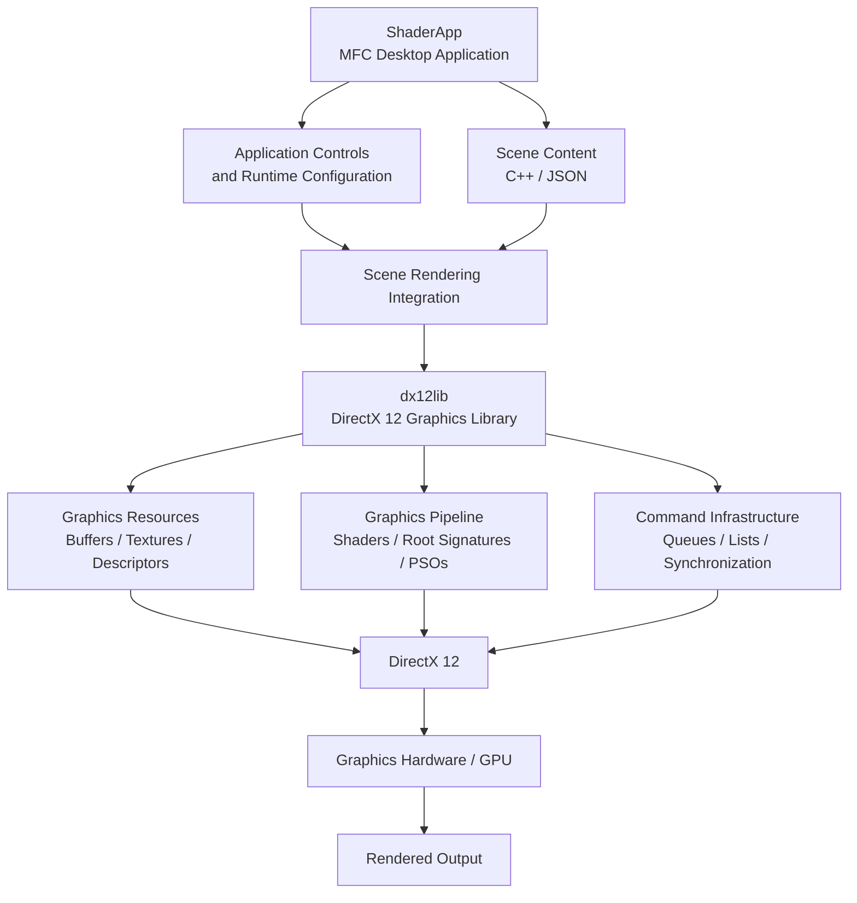

---
### 2.1 Architectural Overview

Charcoal follows a modular application architecture designed to separate desktop application responsibilities from lower-level graphics functionality.

The application is organized around two primary Visual Studio projects: `ShaderApp` and `dx12lib`.

`ShaderApp` serves as the desktop application and provides the environment in which scenes are configured, graphics operations are initiated, and user-facing functionality is exposed.

`dx12lib` provides reusable DirectX 12 functionality, supporting the management of graphics resources and interaction with the rendering API.

Together, these components establish a foundation for rendering three-dimensional environments while allowing application-level functionality and graphics infrastructure to evolve independently.

The architecture is intended to support future expansion into more advanced scene management, asset loading, interactive visualization, and external input processing.

### 2.2 Solution Organization

Charcoal's development environment is organized through a Visual Studio solution containing two principal projects.

|Component|Project Type|Responsibility|
|---|---|---|
|`Charcoal.slnx`|Visual Studio Solution|Organizes the application and its associated library projects.|
|`ShaderApp`|Windows Desktop Executable|Manages application behavior, user-facing controls, scene configuration, and rendering integration.|
|`dx12lib`|Dynamic-Link Library (DLL)|Provides reusable DirectX 12 graphics infrastructure and supporting functionality.|

#### 2.2.1 ShaderApp

`ShaderApp` is the executable application responsible for coordinating Charcoal's runtime environment.

It uses Microsoft Foundation Classes (MFC) for its Windows desktop interface and incorporates application-level functionality required to configure and display graphical scenes.

__Its principal responsibilities include:__
- Establishing the application's desktop environment.
- Managing application-level initialization and shutdown.
- Providing user-facing controls and configuration interfaces.
- Coordinating scene setup and rendering operations.
- Integrating scene definitions and graphics resources.
- Communicating with the underlying rendering infrastructure.

During ALPHA 0.30, `ShaderApp` also contains development-oriented functionality, including test scene configuration and controls used to evaluate rendering systems.

These responsibilities are expected to become more structured as the application architecture evolves.

#### 2.2.2 dx12lib

`dx12lib` is Charcoal's supporting graphics library.

It encapsulates reusable functionality associated with DirectX 12 and provides the infrastructure necessary for GPU-oriented rendering operations.

__The library supports responsibilities associated with:__
- Graphics device and resource management.
- GPU command submission infrastructure.
- Buffer and texture resource handling.
- Descriptor and resource binding operations.
- Graphics pipeline configuration.
- Shader integration.
- Synchronization and supporting DirectX 12 utilities.

Separating this functionality from `ShaderApp` reduces the need for application-specific code to manage every low-level graphics operation directly.

The library is built as a DLL and is a dependency of the `ShaderApp` executable.

### 2.3 Architectural Relationships

The following diagram illustrates the high-level relationship between Charcoal's application components, scene content, rendering infrastructure, and graphics hardware.

**Figure 2.1 — Charcoal ALPHA 0.30 High-Level Architecture**

This diagram presents a conceptual view of the architecture rather than a class-by-class dependency graph. Individual graphics operations may involve functionality distributed between the application, rendering library, and shader programs.

### 2.4 Scene Representation and Configuration

Charcoal ALPHA 0.30 supports scene content defined through application-level C++ code and JSON-based configuration.

This approach provides flexibility during development, allowing graphical systems to be tested using explicitly constructed scenes while introducing the foundation for external scene descriptions.

#### 2.4.1 Hardcoded Scene Content

Hardcoded scene definitions provide a direct method of constructing rendering demonstrations within the application.

These definitions can specify geometric structures, object placement, and scene-specific rendering configurations without requiring a complete generalized asset pipeline.

The Hex Field demonstration uses application-level scene construction to establish its primary geometric environment.

This method is particularly useful during early development because individual rendering systems can be tested against predictable scene content.

However, direct scene construction also introduces tighter coupling between application code and scene configuration.

Future versions are intended to reduce this dependency through improved scene and asset architecture.

#### 2.4.2 JSON-Based Configuration

Charcoal also incorporates JSON-based scene loading functionality, using the `nlohmann/json` library.

JSON provides a structured, human-readable representation of scene information that can be maintained separately from compiled C++ source code.

This introduces a foundation for data-driven scene configuration and reduces the need to recompile the application when modifying supported scene properties.

During ALPHA 0.30, JSON loading remains an evolving component of the architecture.

Scene teardown, resource lifetime management, and integration with the broader rendering infrastructure require additional refinement.

These limitations are relevant to the architectural improvements planned for subsequent versions.

### 2.5 Rendering Infrastructure

Charcoal uses DirectX 12 as its primary graphics API.

DirectX 12 provides explicit control over GPU resources, graphics pipeline configuration, command submission, and synchronization.

Unlike higher-level rendering frameworks, the API places substantial responsibility on the application for correctly managing these operations.

Charcoal's rendering infrastructure is designed around several related components.

#### 2.5.1 Graphics Resources

Graphics resources represent data accessed by the GPU during rendering.

These include vertex and index buffers, constant buffers, textures, depth buffers, and render targets.

Vertex and index buffers describe the geometry submitted for rendering, while constant buffers provide shader-accessible information such as transformation matrices and material properties.

Textures provide image-based surface data and other shader inputs.

Render targets store graphical output, while depth resources support visibility determination between overlapping surfaces.

#### 2.5.2 Resource Binding

DirectX 12 uses descriptors and root signatures to establish how graphics resources are made accessible to shader programs.

Descriptors identify resources such as textures and buffers, while descriptor heaps provide storage for collections of these descriptors.

Root signatures define the resource bindings available to particular shader stages.

Charcoal uses these mechanisms to supply the rendering pipeline with data associated with scene geometry, transformations, materials, textures, and lighting.

Correct resource binding is essential to ensuring that shaders access the intended data.

#### 2.5.3 Graphics Pipeline

The graphics pipeline transforms scene data into rendered output.

Charcoal uses Pipeline State Objects (PSOs) to configure graphics pipeline behavior, including shader programs and relevant fixed-function rendering states.

Vertex shaders process geometric input and associated transformations.

Pixel shaders evaluate surface appearance and produce color output using material properties, textures, and lighting information.

Depth testing contributes to visibility determination, while subsequent rendering operations may apply additional effects to the generated scene.

#### 2.5.4 Command Execution and Synchronization

DirectX 12 uses command lists and command queues to organize and submit work for GPU execution.

Command lists record operations involving graphics resources and rendering commands.

Command queues submit recorded work to the GPU.

Synchronization mechanisms coordinate the execution and completion of graphics operations, helping prevent incorrect resource access and conflicts between CPU and GPU activity.

These systems form an essential part of Charcoal's graphics infrastructure.

The detailed order of command recording, execution, synchronization, and frame presentation is covered in Section 3: Execution Flow.

### 2.6 Rendering System Integration

Charcoal's rendering features operate as interconnected parts of the graphics pipeline rather than as independent visual effects.

Several major subsystems contribute to the final appearance of a rendered scene.

|Subsystem|Architectural Responsibility|
|---|---|
|Geometry|Provides vertex and index data representing three-dimensional objects.|
|Transformations|Supplies world, view, and projection information for spatial rendering.|
|Camera|Determines the viewing configuration used to render the scene.|
|Lighting|Supplies illumination parameters used during shader calculations.|
|Materials|Defines surface properties influencing rendered appearance.|
|Textures|Provides image-based surface information through shader resource bindings.|
|Shaders|Performs GPU-based vertex processing and pixel shading.|
|Post-Processing|Applies image-space effects to rendered scene output.|

These systems exchange information through application-managed scene data, GPU resources, and shader bindings.

For example, a geometric surface may use transformation data to establish its position relative to the camera, material and texture information to determine its surface appearance, and lighting parameters to calculate its final shaded color.

The resulting scene can subsequently be processed using additional image-space effects, such as bloom.

This integration is demonstrated in the Hex Field scene, where multiple rendering features operate together to produce the final visual output.

### 2.7 Shader Architecture

Charcoal uses the High-Level Shading Language (HLSL) to implement GPU-side rendering functionality.

Shader programs are integrated with the DirectX 12 graphics pipeline and operate on data supplied through the application's resource binding configuration.

The primary shader responsibilities include:

**Vertex Processing**

Vertex shaders process geometry and apply the transformations required to position vertices within the rendering pipeline.

**Pixel Shading**

Pixel shaders determine the appearance of rasterized surfaces using available material properties, lighting information, and texture samples.

**Post-Processing**

Post-processing shaders operate on rendered image data to produce additional graphical effects.

ALPHA 0.30 includes bloom-related rendering functionality, which involves processing bright scene regions and combining the resulting effect with the original image.

Shader implementation details, lighting calculations, material parameters, and specific resource bindings are documented in Section 4: Major Systems.

### 2.8 Application and Resource Lifecycle

Charcoal must coordinate resources with different ownership and lifetime requirements.

Application-level objects, scene definitions, graphics resources, and GPU commands do not necessarily share the same lifetime.

For example, graphics resources associated with a scene may need to be replaced or released when the scene changes, while device-level rendering infrastructure remains active.

This separation is important for supporting future dynamic scene loading and runtime interaction.

During ALPHA 0.30, scene loading and teardown remain areas requiring further refinement.

The architecture must eventually support predictable initialization, resource replacement, cleanup, and shutdown without invalidating resources still required by the GPU.

These concerns directly influence the planned scene and asset architecture improvements for ALPHA 0.40.

### 2.9 Architectural Limitations

Although ALPHA 0.30 establishes the application's foundational architecture, several limitations remain.

**Scene and Application Coupling**

Hardcoded scene construction introduces dependencies between application code and graphical content.

**Scene Resource Lifecycle**

JSON-based scene loading is functional, but scene replacement and teardown require additional stabilization.

**Asset Management**

A generalized asset management pipeline is not yet fully established. More extensive model importing and asset organization are planned for future releases.

**Runtime Configuration**

Development-oriented application controls exist, but a more unified runtime interface remains a future architectural objective.

**System Extensibility**

As Charcoal expands into external sensors, audiovisual input, and additional visualization capabilities, clearer subsystem boundaries will become increasingly important.

These limitations provide direction for the next stages of architectural development.

### 2.10 Architectural Direction

ALPHA 0.30 prioritizes a functioning rendering foundation over a fully generalized graphics framework.

Future development will emphasize clearer separation between application controls, scene representation, asset management, and rendering infrastructure.

ALPHA 0.40 will focus on improving scene and asset architecture alongside integration of Dear ImGui for development-oriented runtime controls.

Later releases will expand asset import capabilities, interactive scene configuration, and renderer stability.

Long-term architectural development will also need to accommodate additional data sources, including audio, video, motion tracking, physical sensors, and procedural worldbuilding systems.

By maintaining reusable rendering infrastructure and progressively improving subsystem boundaries, Charcoal can evolve beyond its initial demonstration scenes while preserving its focus on real-time computer graphics experimentation.

### 2.11 Related Documentation

The architecture described in this section provides context for the remaining technical documentation.

|Section|Relationship|
|---|---|
|**1. Overview**|Introduces the application's purpose and rendering capabilities.|
|**3. Execution Flow**|Describes how architectural components participate in application execution and frame rendering.|
|**4. Major Systems**|Explains the implementation and behavior of individual graphics subsystems.|
|**5. Important Source Files**|Identifies the source files implementing the architectural components.|

---

**Charcoal ALPHA 0.30 — Foundational Build**

_Technical Documentation — Section 2: Architecture_