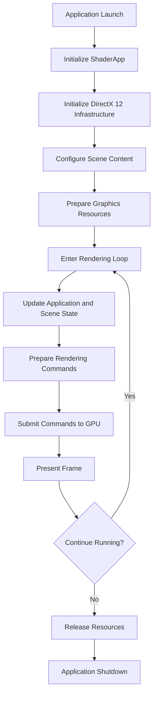
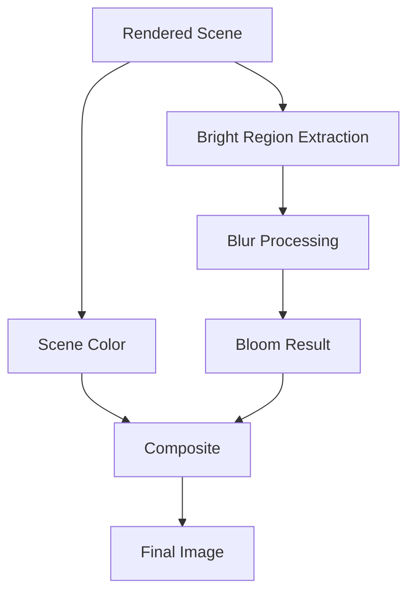
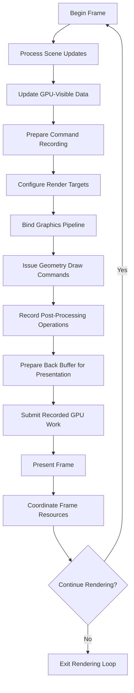

---
### 3.1 Execution Flow Overview

Charcoal's execution flow describes the sequence of operations performed during application startup, scene initialization, rendering, frame presentation, and shutdown.

The application coordinates Windows desktop functionality, scene configuration, graphics resource preparation, and GPU execution through its two primary components: `ShaderApp` and `dx12lib`.

__At a high level, execution is divided into five stages:__
1. **Application Initialization:** Establishes the desktop application environment and initializes the required graphics infrastructure.
2. **Scene Preparation:** Configures scene content, cameras, lights, materials, and the graphics resources required for rendering.
3. **Frame Execution:** Processes application state, prepares GPU commands, and submits rendering operations.
4. **Frame Presentation:** Presents the completed rendering results through the application's swap chain.
5. **Application Shutdown:** Releases application and graphics resources and terminates execution.

These stages provide the foundation for Charcoal's current rendering behavior and establish the sequence that future runtime systems will extend.

### 3.2 High-Level Execution Diagram

The following diagram illustrates the conceptual execution flow of Charcoal ALPHA 0.30.

Figure 3.2.1 — High-level execution flow illustrating Charcoal's initialization, rendering loop, and application shutdown.

This diagram represents the major logical stages of execution. Some preparation and synchronization operations may occur at different points depending on the responsibilities of the underlying graphics components.

### 3.3 Application Initialization

Application initialization prepares the desktop environment and establishes the infrastructure required for rendering.

#### 3.3.1 ShaderApp Initialization

Execution begins when the Windows operating system launches the `ShaderApp` executable.

The application initializes its MFC-based desktop environment, including the application window and associated interface components.

Application-level initialization also establishes the state required for the rendering system and development-oriented controls.

The exact order of individual application callbacks depends on the implementation of the MFC application and dialog classes.

#### 3.3.2 DirectX 12 Initialization

After the application environment has been established, the graphics infrastructure must be initialized.

The DirectX 12 rendering environment requires several fundamental components:
- A compatible graphics device.
- Command queue and command recording infrastructure.
- A swap chain for presenting rendered frames.
- Render targets associated with swap-chain buffers.
- Depth and stencil resources where required.
- Descriptor heaps for graphics resource bindings.
- Synchronization mechanisms for coordinating CPU and GPU operations.

These components establish the resources necessary for recording graphics commands, executing them on the GPU, and presenting the resulting images.

The `dx12lib` library provides reusable functionality supporting DirectX 12 operations, while `ShaderApp` coordinates their application-level use.

Successful initialization allows the application to proceed to scene preparation.

### 3.4 Scene Preparation

Scene preparation establishes the content and resources necessary to render a three-dimensional environment.

During ALPHA 0.30, Charcoal uses a combination of hardcoded C++ scene definitions and JSON-based scene configuration.

The scene preparation process can be understood through several logical operations.

#### 3.4.1 Scene Configuration

The application establishes the scene content to be rendered.

Scene definitions may provide information associated with:
- Three-dimensional geometry.
- Object transformations.
- Camera configuration.
- Lighting parameters.
- Material properties.
- Texture references.
- Scene-specific rendering settings.

The Hex Field serves as the principal rendering demonstration for ALPHA 0.30.

Its configuration provides a controlled environment for testing the interaction between geometry, lighting, materials, textures, and post-processing.

#### 3.4.2 Geometry Preparation

Geometry must be represented in a format suitable for GPU rendering.

Vertex data describes the geometric attributes of a mesh, while index data may specify how vertices are assembled into primitives.

Depending on the rendering implementation, vertex attributes can include positions, texture coordinates, and surface normals.

The rendering infrastructure prepares the buffers necessary to make this data available to the graphics pipeline.

#### 3.4.3 Material and Texture Preparation

Material configuration establishes the properties used to calculate the appearance of geometric surfaces.

Associated textures are loaded and prepared as GPU-accessible resources.

These resources are connected to shader programs through DirectX 12 resource binding mechanisms.

ALPHA 0.30 incorporates texture sampling for surface coloration and additional surface-detail information.

#### 3.4.4 Camera and Lighting Preparation

The camera establishes the viewpoint used to render the scene.

World, view, and projection transformations determine how three-dimensional geometry is positioned relative to the camera and projected into the rendered image.

Lighting configuration supplies the parameters required by the scene's illumination calculations.

ALPHA 0.30 supports directional, point, and spot lighting, allowing multiple illumination sources to contribute to the appearance of the Hex Field.

#### 3.4.5 Pipeline Preparation

The graphics pipeline must be configured before rendering operations can execute.

Pipeline preparation involves appropriate shader programs, root signatures, pipeline state objects, and resource bindings.

These components collectively define how geometry and associated data are processed by the GPU.

Once the necessary resources and pipeline configurations are available, the application can begin rendering frames.

### 3.5 Frame Execution

Frame execution represents the recurring sequence of operations responsible for generating graphical output.

Unlike initialization, which generally occurs when the application or scene is prepared, frame execution repeats while rendering remains active.

#### 3.5.1 Application and Scene Updates

At the beginning of a rendering iteration, Charcoal may process changes originating from application controls or scene configuration.

Examples include adjustments to:

- Camera position and orientation.
- Object transformations.
- Light properties.
- Material parameters.
- Rendering configuration.

These changes must be reflected in the data supplied to the GPU before their effects can appear in the rendered scene.

The current implementation uses development-oriented controls to expose selected rendering parameters.

#### 3.5.2 Updating Shader Data

Information required by the shaders is prepared for the rendering pipeline.

This can include transformation matrices, material constants, and lighting data.

The application must ensure that shader-visible resources contain the appropriate values and that resource updates are synchronized with GPU access.

Some resources may remain unchanged between frames, while others require updates when scene or application state changes.

#### 3.5.3 Recording Rendering Commands

DirectX 12 rendering operations are recorded into command lists.

A rendering pass generally requires the application to establish the appropriate graphics state before issuing draw commands.

Relevant operations may include:
- Preparing render targets and depth resources.
- Applying required resource state transitions.
- Clearing render targets and depth buffers.
- Binding a graphics pipeline state.
- Binding the corresponding root signature.
- Configuring resource descriptors and shader inputs.
- Binding vertex and index buffers.
- Issuing draw calls.

These commands describe the work that the GPU will execute to generate the scene.

The precise command organization is determined by Charcoal's rendering implementation.

#### 3.5.4 GPU Command Submission

After recording, command lists are submitted to an appropriate DirectX 12 command queue.

The GPU executes the submitted commands according to the ordering and synchronization requirements established by the application.

This separation allows the CPU to prepare commands while the GPU performs graphics processing.

Correct coordination is essential because CPU-side resource updates and GPU-side rendering operations may otherwise attempt to access the same resources at incompatible times.

### 3.6 Rendering Pipeline

The rendering pipeline transforms scene geometry and associated graphical data into image output.

For Charcoal ALPHA 0.30, the primary graphics processing stages include vertex processing, primitive assembly, rasterization, pixel shading, and render-target output.

#### 3.6.1 Vertex Processing

Vertex shaders process incoming vertex attributes and apply the required transformations.

World transformations position objects within the scene.

View transformations express scene positions relative to the camera.

Projection transformations prepare three-dimensional positions for rasterization and image generation.

Additional vertex attributes may be passed to subsequent pipeline stages for use during surface shading.

#### 3.6.2 Primitive Assembly and Rasterization

The graphics pipeline assembles geometric primitives from the supplied vertex and index data.

Rasterization determines which screen-space fragments are covered by those primitives.

Depth testing is used to resolve visibility between overlapping surfaces.

This allows Charcoal to render spatially arranged geometry with appropriate occlusion.

#### 3.6.3 Pixel Shading

Pixel shaders determine surface appearance using the inputs available to the rendering pipeline.

These inputs may include:
- Surface normals.
- Material properties.
- Texture samples.
- Directional, point, and spot lighting information.
- Emissive surface properties.

The resulting calculations determine the color written to the associated rendering target.

The exact lighting and material calculations are examined in Section 4: Major Systems.

### 3.7 Post-Processing

Following primary scene rendering, Charcoal can perform image-space operations to modify the rendered result.

ALPHA 0.30 incorporates bloom, which visually enhances bright regions of the scene.

Conceptually, bloom processing involves identifying bright image regions, applying a blur operation to the selected image information, and combining the result with the original scene.

The effect is particularly useful for the Hex Field's emissive surfaces, creating a visible glow around bright portions of the environment.

The following diagram illustrates this conceptual relationship.

Figure 3.7.1 — Conceptual bloom processing flow, showing how the original scene and processed bright regions contribute to the final image.

This diagram describes the intended visual processing relationship rather than an exact accounting of every render target, intermediate buffer, or shader dispatch.

The specific implementation of the bloom passes, including resource formats and rendering operations, belongs in Section 4: Major Systems.

### 3.8 Frame Presentation

After the required scene rendering and post-processing operations have been prepared and executed in the appropriate order, the resulting image is made available for presentation.

DirectX 12 applications commonly use a DXGI swap chain to manage the buffers associated with displayed frames.

The rendering process must ensure that the selected back buffer is in the appropriate resource state before presentation.

The application's presentation operation then makes the rendered frame available to the windowing system for display.

Following presentation, the application prepares to continue rendering using the next appropriate frame resources.

The transition between frames must respect the synchronization requirements associated with command execution, resource reuse, and swap-chain buffer management.

### 3.9 Rendering Loop Diagram

The following diagram provides a more technical representation of the recurring rendering process.

Figure 3.9.1 — Conceptual rendering loop showing scene updates, command preparation, geometry rendering, post-processing, and presentation.

The diagram does not prescribe the precise number of command lists or queue submissions used by Charcoal. Actual implementations may submit work at intermediate stages rather than collecting all recorded operations into one final submission.

Likewise, CPU-side presentation and GPU-side execution are coordinated but do not necessarily occur as a strictly sequential, fully blocking process.

### 3.10 Synchronization and Resource Management

DirectX 12 places responsibility for resource management and synchronization on the application.

Charcoal must coordinate operations involving graphics resources shared between CPU and GPU execution.

Important considerations include:

**Resource State Management**

Resources must occupy appropriate states for their intended operations, including rendering, shader access, copying, and presentation.

**Command Execution**

Commands must be recorded and submitted in a sequence that respects graphics dependencies.

**GPU Synchronization**

Fence-based synchronization can establish when submitted GPU work has reached a specified completion point.

**Frame Resource Reuse**

Resources associated with earlier frames must not be overwritten or released while the GPU still requires them.

**Scene Resource Lifetime**

Scene-specific graphics resources must be managed correctly during scene replacement, application shutdown, and other resource lifecycle operations.

ALPHA 0.30 includes ongoing work to improve scene teardown and resource stability, particularly in relation to JSON-based scene loading.

These considerations become increasingly important as Charcoal evolves toward more dynamic scene and asset management.

### 3.11 Application Shutdown

Application shutdown occurs when the user exits Charcoal or the application otherwise terminates its normal execution.

A correctly coordinated shutdown process must account for both application-managed objects and resources associated with outstanding GPU operations.

__The conceptual shutdown sequence includes:__
1. Stop initiating new rendering work.
2. Ensure that graphics operations requiring existing resources have completed.
3. Release scene-specific graphics resources.
4. Release remaining graphics infrastructure and application-owned resources.
5. Destroy the application environment and terminate execution.

Graphics resource cleanup must follow the actual ownership and synchronization rules of the implementation.

The order in which individual objects are destroyed can be significant, especially when their underlying resources are shared or referenced elsewhere.

The stabilization of scene teardown remains an area of development in ALPHA 0.30.

### 3.12 Execution Flow Limitations

The execution flow described in this document represents Charcoal's ALPHA 0.30 rendering model at a conceptual level.

Several aspects remain under development.

**Scene Replacement**

JSON scene loading exists, but resource teardown and replacement are not yet fully stabilized.

**Runtime Scene Management**

The application does not yet provide a fully generalized system for dynamically managing all scene entities and assets.

**Rendering Controls**

Selected rendering parameters can be adjusted using development-oriented controls, but unified runtime tooling remains a future objective.

**Performance Instrumentation**

More comprehensive profiling and graphics debugging workflows are planned for later development.

**External Input Processing**

Audio, video, motion tracking, and physical sensor input are part of Charcoal's broader direction but are not represented as integrated ALPHA 0.30 execution stages.

Future releases will extend the application's execution flow to accommodate these systems without compromising the stability of the underlying rendering infrastructure.

### 3.13 Related Documentation

|Section|Relationship|
|---|---|
|**1. Overview**|Introduces Charcoal and its foundational rendering capabilities.|
|**2. Architecture**|Explains the architectural components involved in execution.|
|**4. Major Systems**|Documents the rendering systems used during frame execution.|
|**5. Important Source Files**|Identifies the source code responsible for the documented operations.|

---

**Charcoal ALPHA 0.30 — Foundational Build**

_Technical Documentation — Section 3: Execution Flow_