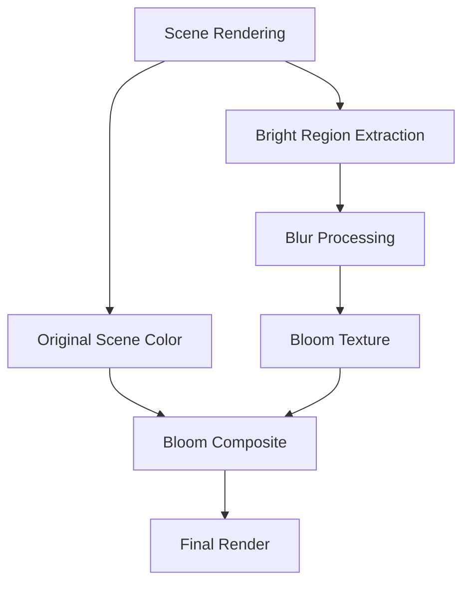
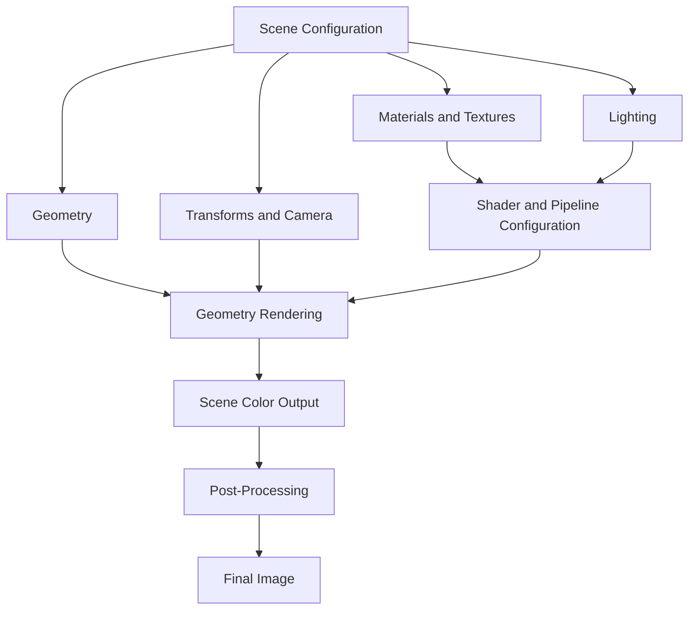

---
### 4.1 Major Systems Overview

Charcoal ALPHA 0.30 introduces and integrates several foundational systems responsible for three-dimensional rendering.

These systems operate together to transform geometric and scene information into graphical output using the DirectX 12 rendering pipeline.

__The principal systems documented in this section include:__
1. Geometry and Mesh Rendering
2. Spatial Transformations
3. Camera System
4. Depth Testing
5. Lighting System
6. Material System
7. Texture Mapping and Sampling
8. Shader System
9. Emissive Rendering
10. Bloom and Post-Processing
11. Scene Configuration
12. Debugging and Diagnostics

While some of these systems were introduced during earlier development milestones, ALPHA 0.30 significantly expands their integration and capabilities.

The Hex Field serves as the principal testing environment, allowing the behavior of multiple rendering systems to be evaluated within a consistent three-dimensional scene.

### 4.2 Geometry and Mesh Rendering

#### 4.2.1 Purpose

The geometry system establishes the three-dimensional structures rendered by Charcoal.

Geometry is represented using mesh data containing vertex attributes and, where applicable, indices defining how vertices are assembled into geometric primitives.

The rendering system processes these structures through the DirectX 12 graphics pipeline to produce rasterized geometry.

#### 4.2.2 Vertex Representation

Vertex data contains information required by the graphics pipeline to represent and shade geometric surfaces.

__Depending on the mesh format and rendering configuration, vertex attributes include:__
- Position coordinates.
- Surface normals.
- Texture coordinates.
- Additional attributes required by supported shaders.

Vertex positions describe the structure of the mesh, while normals supply directional information used during lighting calculations.

Texture coordinates establish the mapping between geometric surfaces and texture resources.

#### 4.2.3 GPU Geometry Resources

Mesh data must be made accessible to the graphics pipeline before rendering.

Vertex buffers store the vertex attributes associated with the geometry.

Index buffers, when used, specify the ordering of vertices required to assemble primitives.

During rendering, these resources are bound to the input-assembler stage before the appropriate draw operations are issued.

#### 4.2.4 Hex Field Geometry

The Hex Field demonstration uses repeated hexagonal structures arranged within a three-dimensional environment.

The scene provides a consistent geometric basis for evaluating material properties, surface illumination, texture sampling, and camera behavior.

Its repeated geometry makes differences between rendering configurations easier to observe.

**Suggested Figure 4.1 — Initial Hex Field Geometry**
![[figure4-1.png]]

The geometry system establishes the structural foundation upon which the remaining rendering features operate.

### 4.3 Spatial Transformations

#### 4.3.1 Purpose

Spatial transformations determine how three-dimensional objects are positioned, oriented, scaled, and projected into the rendered image.

Charcoal uses transformation matrices to relate object geometry to the world, camera, and projection spaces.

#### 4.3.2 World Transformation

The world transformation positions an object within the scene.

__It can incorporate:__
- Translation.
- Rotation.
- Scaling.

These operations establish an object's spatial relationship to the environment and other scene objects.

#### 4.3.3 View Transformation

The view transformation converts world-space positions into a coordinate system relative to the camera.

It represents the position and orientation of the observer within the scene.

#### 4.3.4 Projection Transformation

The projection transformation determines how camera-space geometry is mapped into clip space for subsequent processing.

Perspective projection allows objects at different distances to exhibit the apparent size relationships associated with three-dimensional viewing.

#### 4.3.5 World-View-Projection

The combined transformation is commonly expressed as:

$$P_{clip} = P_{local} \times W \times V \times P$$

where:
- $(P_{local})$ represents a vertex position in object-local coordinates.
- $(W)$ represents the world transformation.
- $(V)$ represents the view transformation.
- $(P)$ represents the projection transformation.

This expression assumes row-vector multiplication; the exact multiplication convention and matrix layout must match the C++ and HLSL implementations.

The resulting clip-space position is used by subsequent graphics pipeline stages.

### 4.4 Camera System

#### 4.4.1 Purpose

The camera system determines the viewpoint from which Charcoal renders a scene.

The camera provides the information required to construct the view and projection transformations used by the graphics pipeline.

#### 4.4.2 Camera Properties

**Relevant camera properties include:**
- Camera position.
- Camera orientation or target.
- Viewing direction.
- Field of view.
- Aspect ratio.
- Near and far clipping planes.

These properties influence the spatial composition and perspective of the rendered environment.

#### 4.4.3 Camera Configuration

During ALPHA 0.30, the application supports a default camera configuration and development-oriented controls for modifying camera parameters.

The camera configuration is particularly important for the Hex Field, where the chosen perspective affects the visibility of platform surfaces, surrounding structures, and lighting effects.

The application also incorporates safeguards related to camera orientation calculations.

Further runtime camera control and interaction are planned for later development milestones.

### 4.5 Depth Testing

#### 4.5.1 Purpose

Depth testing determines which geometric surfaces are visible when multiple objects overlap in screen space.

Without depth testing, overlapping geometry may be rendered incorrectly depending on draw order.

#### 4.5.2 Depth Buffer

A depth buffer stores depth information associated with rendered fragments.

During rasterization, incoming fragment depth values can be evaluated against the existing depth buffer contents.

The configured depth comparison operation determines whether a fragment passes the depth test.

#### 4.5.3 Hex Field Application

Depth testing is essential to the Hex Field because the scene contains numerous geometric surfaces arranged at different positions and depths.

Correct depth handling allows nearer hexagonal structures to obscure surfaces located behind them.

This contributes to the scene's perception of three-dimensional space.

### 4.6 Lighting System

#### 4.6.1 Purpose

The lighting system determines how illumination influences the appearance of rendered surfaces.

Lighting calculations use information such as surface orientation, material properties, and light configuration to determine the resulting shaded appearance.

__ALPHA 0.30 incorporates three primary light types:__
- Directional Light
- Point Light
- Spot Light

These light types provide different methods of illuminating geometry and can be combined within a single scene.

#### 4.6.2 Directional Lighting

Directional lighting represents illumination arriving from a specified direction.

A directional light does not use a localized source position when determining its incident lighting direction.

This makes it useful for broad illumination across a scene.

Within the Hex Field, directional lighting contributes to the overall appearance of surfaces and provides a foundation for evaluating material response.

**Suggested Figure 4.2 — Directional Lighting Test**
![[figure4-2.png]]

#### 4.6.3 Point Lighting

Point lights represent localized light sources that emit illumination outward from a position in three-dimensional space.

Surface illumination depends on the relationship between the light position and the surface being shaded.

Distance attenuation can reduce the light's contribution as the distance from the source increases.

Within the Hex Field, point lights contribute localized illumination near the hexagonal structures and their illuminated regions.

**Suggested Figure 4.3 — Point Lighting Test**
![[figure4-3.png]]

#### 4.6.4 Spot Lighting

Spot lights provide directional illumination originating from a defined position.

Unlike point lights, their influence is concentrated within an angular region.

Spot lighting configurations typically involve a light position, a direction, and parameters controlling the angular extent or falloff of the illuminated region.

Within the Hex Field, spot lighting provides more focused illumination and contributes to the visual separation of foreground and surrounding geometry.

**Suggested Figure 4.4 — Spot Lighting Test**
![[figure4-5.png]]

#### 4.6.5 Combined Lighting

The Hex Field uses multiple light types to produce its overall appearance.

Directional lighting contributes broader illumination, while point and spot lights provide localized and directional accents.

The combined lighting configuration allows different parts of the scene to exhibit distinct brightness and surface characteristics.

**Suggested Figure 4.5 — Combined Lighting**
![[figure4-4.png]]

The exact light accumulation calculations, attenuation equations, and shader data structures depend on the implemented lighting shader.

### 4.7 Material System

#### 4.7.1 Purpose

Materials define properties that influence the appearance of rendered geometry.

Rather than relying exclusively on geometric structure, material information allows surfaces to respond differently to illumination and texture sampling.

#### 4.7.2 Material Properties

Material properties used during ALPHA 0.30 development include surface coloration and parameters influencing lighting and emissive appearance.

__Relevant material information can include:__
- Base surface color.
- Texture references.
- Surface normal information.
- Emissive color or intensity.
- Other shader-specific material parameters.

The availability and behavior of individual properties are determined by the active shader configuration.

#### 4.7.3 Material and Lighting Interaction

Surface appearance results from the interaction between material properties and lighting calculations.

A material's response depends on the shader's implemented lighting model and the information supplied through its bindings.

For example, surfaces with different normal orientations can receive different lighting contributions, even when they use identical color textures.

This relationship is central to the Hex Field's material and lighting tests.

#### 4.7.4 Material Rendering Models

Physically based rendering models commonly use bidirectional reflectance distribution functions (BRDFs) to describe how light reflects from a surface.

However, the presence of material properties and multiple light types does not by itself establish that a renderer uses a particular BRDF.

The specific reflectance model implemented in Charcoal ALPHA 0.30 should be documented from the active HLSL lighting functions rather than inferred from the appearance of the scene.

### 4.8 Texture Mapping and Sampling

#### 4.8.1 Purpose

Texture mapping allows image-based information to influence rendered surfaces.

Textures provide detail that would otherwise require additional geometry or more complex procedural calculations.

ALPHA 0.30 expands the Hex Field's rendering capabilities through multiple texture inputs.

#### 4.8.2 Albedo / Base Color

An albedo or base-color texture provides surface color information.

Texture coordinates determine how the image is sampled across the geometric surface.

Within the Hex Field, base-color textures allow the hexagonal structures to display surface variation beyond a uniform material color.

Color textures may require sRGB-aware sampling to support appropriate color-space handling.

#### 4.8.3 Normal Mapping

Normal mapping modifies the surface normal information used in lighting calculations.

Instead of altering the mesh geometry, a normal texture provides directional information that changes the apparent orientation of the surface during shading.

This can create the appearance of small-scale surface detail without increasing the mesh's geometric complexity.

Correct interpretation of a normal texture depends on the coordinate-space convention and the supporting shader transformations.

#### 4.8.4 Bump and Height Mapping

Height textures represent relative surface elevation using image-based values.

These textures can support different surface-detail techniques depending on how their values are interpreted by the shader.

For example, bump mapping can use height variation to perturb the lighting normal, while displacement-based approaches alter geometric or sampled surface positions.

A height texture does not automatically imply geometric displacement.

The distinction between bump, height, and normal mapping is important when evaluating Charcoal's implemented texture functionality.

#### 4.8.5 Texture Comparison

During ALPHA 0.30 development, the Hex Field was used to evaluate different combinations of surface-detail inputs.

These comparisons help establish how texture information contributes to material appearance under the same geometric and lighting conditions.

**Suggested Figure 4.6 — Surface Texture Comparison**

| Base / Albedo                             | Normal Mapping                            | Combined Surface Detail                   |
| ----------------------------------------- | ----------------------------------------- | ----------------------------------------- |
| ![[figure4-7-1.png\|254]] | ![[figure4-6.png\|249]] | ![[figure4-7-2.png\|248]] |
_Figure 4.6 — Comparison of texture configurations applied to Hex Field surfaces._

Screenshots should be labeled according to the texture inputs and shader features actually enabled during capture.

#### 4.8.6 Texture Resource Binding

DirectX 12 shaders access textures through configured shader resources.

Shader Resource Views (SRVs) provide shader-accessible descriptions of the underlying texture resources.

Sampler states determine how texture coordinates are used to retrieve texture data.

Charcoal's texture integration relies on compatible resource bindings between its C++ rendering code and HLSL shader declarations.

### 4.9 Shader System

#### 4.9.1 Purpose

The shader system defines GPU-executed operations used to process geometry, evaluate surface appearance, and apply image-space effects.

Charcoal uses HLSL to implement shader programs integrated into the DirectX 12 rendering pipeline.

#### 4.9.2 Vertex Shaders

Vertex shaders process the input vertex attributes associated with submitted geometry.

Their responsibilities include transforming vertex positions into clip space and supplying interpolated attributes to later pipeline stages.

These attributes can include texture coordinates, transformed surface normals, and positional information required for lighting.

#### 4.9.3 Pixel Shaders

Pixel shaders determine the final shaded appearance of rasterized surfaces.

__They may combine:__
- Sampled texture data.
- Material parameters.
- Surface normals.
- Light properties.
- Emissive contributions.

The resulting output is written to the active render target.

#### 4.9.4 Root Signatures and Pipeline State Objects

Root signatures define how shader-accessible resources are bound to the graphics pipeline.

Pipeline State Objects (PSOs) describe the configured graphics pipeline state, including shader programs and relevant rendering settings.

Charcoal's HLSL programs and C++ resource bindings must agree on their register assignments and expected data layouts.

Incorrect configurations can produce shader compilation failures, graphics validation errors, or unintended rendering behavior.

During ALPHA 0.30, shader compilation and pipeline configuration were among the areas investigated and refined during renderer development.

### 4.10 Emissive Rendering

#### 4.10.1 Purpose

Emissive rendering allows surfaces to contribute visible color independent of ordinary incident-light shading.

This provides a method for representing surfaces that appear internally illuminated, such as glowing panels or energy-like structures.

#### 4.10.2 Emissive Material Contribution

An emissive material adds a configured contribution to the surface's shaded output.

Its appearance depends on the shader implementation, emissive color, intensity, and subsequent image processing.

Emission should be distinguished from actual illumination of surrounding geometry.

An emissive material does not automatically cast light onto nearby objects unless the renderer implements an additional mechanism for transferring that illumination.

#### 4.10.3 Hex Field Application

The Hex Field uses emissive surface coloration to emphasize selected regions of the hexagonal structures.

During development, multiple configurations were tested to refine the appearance of illuminated surfaces.

These experiments included changes to emissive coloration, intensity, and the relationship between emissive regions and the surrounding dark materials.

**Suggested Figure 4.7 — Emissive Material Tests**
![[figure4-7.png]]

### 4.11 Bloom and Post-Processing

#### 4.11.1 Purpose

Post-processing modifies rendered image data after the primary scene rendering operations.

Bloom is an image-space effect that produces visible glow around bright regions.

Charcoal ALPHA 0.30 incorporates bloom to enhance the appearance of emissive surfaces within the Hex Field.

#### 4.11.2 Bloom Processing

__The conceptual bloom process contains several stages:__
1. Render the scene to an appropriate color target.
2. Identify or extract bright image regions.
3. Apply blur processing to the selected image information.
4. Combine the blurred result with the original scene.
5. Produce the composited image for presentation.

The process can be represented as follows:

_Figure 4.8 — Conceptual bloom processing pipeline._
![[figure4-7-3.png]]

#### 4.11.3 Bloom Strength

Bloom strength controls the contribution of the processed glow relative to the original scene.

Higher strength values can produce a more pronounced glow, while lower values preserve greater separation between bright regions and the surrounding environment.

During development, bloom strength was adjusted to evaluate its influence on the Hex Field's emissive surfaces.

The objective was to achieve a visually distinct glow without obscuring the geometric and material detail of the scene.

#### 4.11.4 Bloom Comparison

**Suggested Figure 4.9 — Bloom Configuration Comparison**

| Reduced Bloom                             | Increased Bloom                           |
| ----------------------------------------- | ----------------------------------------- |
| ![[low-bump.png\|349]] | ![[high-bump.png\|348]] |
_Figure 4.9 — Comparison demonstrating the effect of bloom strength on emissive Hex Field surfaces._

For an accurate comparison, the source images should use the same camera position, geometry, and lighting configuration, with bloom being the principal changed parameter.

#### 4.11.5 Bloom and Surface Illumination

Bloom should not be confused with physically simulated light emission.

Bloom spreads bright image information in screen space, creating the appearance of glow.

It does not inherently calculate indirect illumination, light transport, or the amount of radiance transferred between surfaces.

Within Charcoal, bloom contributes primarily to the visual presentation of bright and emissive regions, while the lighting system is responsible for its implemented surface illumination calculations.

### 4.12 Scene Configuration and Rendering Integration

#### 4.12.1 Purpose

Scene configuration coordinates the content and rendering parameters required to construct the displayed environment.

During ALPHA 0.30, this functionality combines C++ scene construction with JSON-based loading.

#### 4.12.2 Hardcoded Scene Construction

Hardcoded scene definitions allow rendering demonstrations to be assembled directly through application-level code.

The Hex Field uses this approach to provide a controlled environment for graphics system development.

This allows rendering features to be tested without requiring a generalized external asset-loading pipeline.

#### 4.12.3 JSON Scene Loading

JSON-based loading introduces external scene configuration through structured data.

Charcoal uses `nlohmann/json` to support JSON processing.

Although scene loading is functional, resource cleanup and scene teardown require further stabilization.

These limitations are relevant to the planned architectural improvements of ALPHA 0.40.

#### 4.12.4 Rendering Integration

Scene configuration connects the other graphics systems by establishing the geometry, camera, lighting, and material state used during rendering.

As Charcoal evolves, a more structured scene model will help reduce dependencies between scene-specific content and low-level rendering implementation.

### 4.13 Debugging and Diagnostics

#### 4.13.1 Purpose

Graphics debugging is essential to identifying problems involving GPU resource management, shader execution, pipeline configuration, and rendering output.

DirectX 12 provides validation and debugging capabilities that support investigation of these problems.

#### 4.13.2 Debug Layer

Charcoal's development configuration uses the DirectX 12 debug layer.

The debug layer can identify invalid API usage, incorrect resource operations, and other graphics programming errors.

This is particularly useful when investigating synchronization, resource binding, and pipeline configuration issues.

#### 4.13.3 Application Logging

Application-level logging provides information about initialization, rendering behavior, resource operations, and error conditions.

Diagnostic output helps identify the sequence of operations leading to a failure and provides context when testing graphics features.

#### 4.13.4 Graphics Inspection Tools

Graphics inspection tools such as RenderDoc and PIX can assist in investigating frame execution and GPU rendering behavior.

__Relevant capabilities include:__
- Capturing rendered frames.
- Inspecting draw calls.
- Examining pipeline state.
- Inspecting bound textures and buffers.
- Evaluating resource usage.
- Investigating rendering errors.

These tools are part of Charcoal's planned validation and optimization workflow.

Their inclusion in this documentation does not imply that a complete profiling and capture workflow has already been established.

### 4.14 System Interdependencies

Charcoal's major systems are interconnected.

Geometry establishes the three-dimensional structures used by the renderer.

Transformations and camera configuration determine how those structures are represented in the rendered viewpoint.

Material and texture data define surface characteristics, while lighting calculations influence their appearance.

Shader programs process this information through the graphics pipeline, producing the rendered scene.

Post-processing subsequently modifies the image to produce additional effects.

The following diagram summarizes these relationships.

_Figure 4.10 — Relationship between Charcoal's foundational rendering systems._

The diagram represents conceptual data dependencies rather than the exact order of individual API calls.

### 4.15 Current Limitations

Although ALPHA 0.30 establishes a functional rendering foundation, several major systems remain limited in scope.

**Geometry and Assets**

Generalized model importing and broader asset management are planned for later development.

**Materials**

The material system remains subject to continued expansion, including improved organization of surface parameters and texture inputs.

**Scene Management**

Scene representation, resource ownership, and JSON-based teardown require architectural refinement.

**Runtime Controls**

Development-oriented controls exist, but unified scene editing and runtime configuration interfaces remain future objectives.

**Rendering Optimization**

Comprehensive GPU profiling, performance characterization, and hardware compatibility testing have not yet been established as completed features.

**Advanced Graphics**

More advanced rendering techniques, procedural visualization, and additional spatial systems remain outside the immediate scope of ALPHA 0.30.

These limitations guide the next stages of development.

### 4.16 Future System Development

The rendering systems established in ALPHA 0.30 provide the foundation for subsequent Charcoal releases.

ALPHA 0.40 will focus on scene and asset architecture improvements and Dear ImGui integration.

Later releases are intended to expand model importing, material and texture workflows, runtime controls, and application stability.

Long-term development will extend these foundations to support additional graphics applications, procedural effects, audiovisual input, motion tracking, sensor integration, and worldbuilding.

This progression will allow Charcoal to evolve from a foundational rendering environment into a broader platform for real-time computer graphics experimentation.

### 4.17 Related Documentation

|Section|Relationship|
|---|---|
|**1. Overview**|Introduces the rendering capabilities demonstrated by Charcoal.|
|**2. Architecture**|Describes the organization of the application and its graphics infrastructure.|
|**3. Execution Flow**|Explains how rendering systems participate in frame execution.|
|**5. Important Source Files**|Identifies the source files responsible for implementing these systems.|

---

**Charcoal ALPHA 0.30 — Foundational Build**

_Technical Documentation — Section 4: Major Systems_