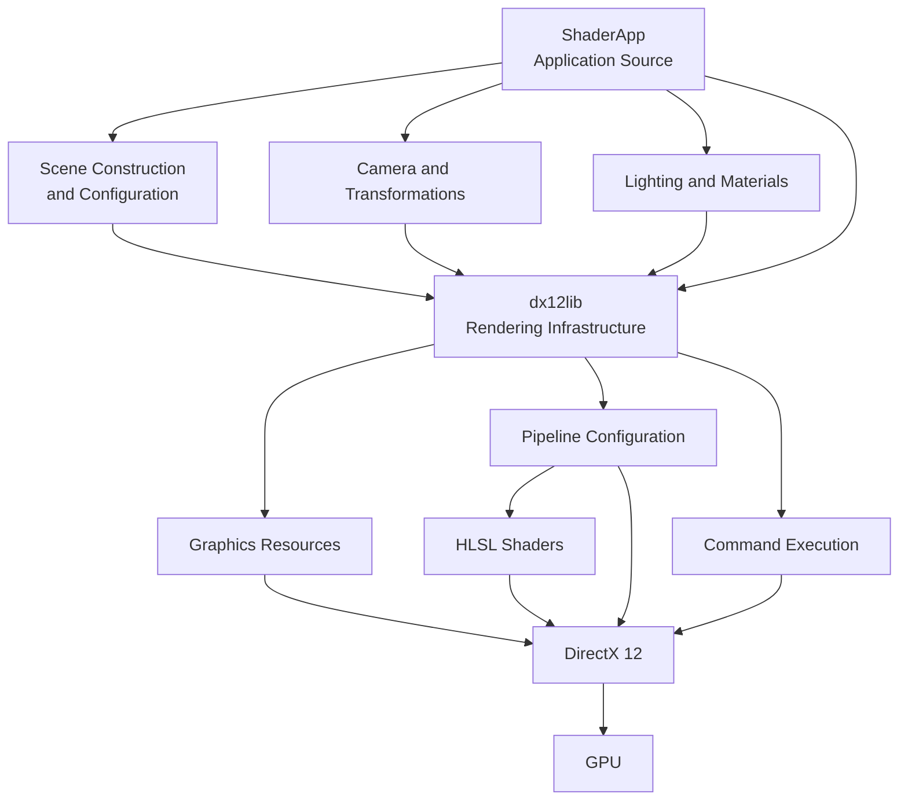

---
### 5.1 Source File Overview

Charcoal's source code is organized around a Windows desktop application and a supporting DirectX 12 graphics library.

The codebase contains functionality responsible for application initialization, rendering infrastructure, graphics resource management, scene construction, lighting, materials, texture sampling, shader execution, and post-processing.

__The two principal projects are:__
- **ShaderApp:** The application-level project responsible for the desktop environment, scene integration, and rendering controls.
- **dx12lib:** The supporting dynamic-link library providing reusable DirectX 12 functionality.

This document identifies the important source files and logical source groups associated with Charcoal ALPHA 0.30.

Its purpose is to assist developers in navigating the codebase, understanding component responsibilities, and identifying where major rendering features are implemented.

The file inventory is organized by architectural responsibility rather than by filename alone.

### 5.2 Solution and Project Configuration

Charcoal uses a Visual Studio solution to organize the application and graphics library.

|File / Component|Responsibility|
|---|---|
|`Charcoal.slnx`|Visual Studio solution containing the application's principal projects.|
|`ShaderApp` project configuration|Defines the desktop application's build configuration and dependencies.|
|`dx12lib` project configuration|Defines the graphics library's build configuration and dependencies.|
|`.gitignore`|Excludes selected generated files and local development artifacts from version control.|
|`.gitattributes`|Defines repository file attributes, including Git LFS tracking where configured.|

The solution maintains a dependency relationship between `ShaderApp` and `dx12lib`.

The graphics library must be built before the application can successfully link against the functionality it provides.

This arrangement separates reusable rendering infrastructure from application-specific behavior and allows both projects to be maintained within a common development environment.

### 5.3 Application Source Files — ShaderApp

#### 5.3.1 Application Initialization

The `ShaderApp` project contains the Windows desktop application's initialization and lifecycle functionality.

Its application and dialog classes are responsible for establishing the desktop environment and coordinating the use of the graphics library.

__Relevant responsibilities include:__
- Application startup.
- Initialization of the MFC application environment.
- Creation and management of application windows.
- Initialization of application-level rendering components.
- User interface event handling.
- Application shutdown.

The exact source files implementing these responsibilities should be identified from the current MFC application and dialog class definitions.

#### 5.3.2 Rendering Controls

ALPHA 0.30 includes development-oriented controls used to modify selected rendering parameters.

These controls provide a means of evaluating the behavior of graphics features without modifying every parameter directly in source code.

Relevant controls include camera configuration and selected lighting or material settings.

The associated event handlers connect interface changes to the corresponding application or rendering state.

A more unified runtime interface is planned for subsequent versions.

### 5.4 Scene Construction Source Files

#### 5.4.1 Hex Field Scene

The Hex Field is Charcoal's primary rendering demonstration for ALPHA 0.30.

Its scene construction functionality provides the geometry and configuration required to evaluate the application's foundational rendering capabilities.

Known source identifiers associated with this work include:

|Identifier|Responsibility|
|---|---|
|`HexCorridorScene`|Scene implementation used to construct the hexagonal environment.|
|`BuildHexCorridorScene`|Scene-building function associated with the Hex Field geometry.|
|`SceneVertex`|Vertex representation used by scene geometry construction.|
|`SceneGeometry`|Geometry-related data representation used during scene construction.|

These identifiers were used during ALPHA 0.30 development. Their current declarations, definitions, and file locations should be verified against the repository.

#### 5.4.2 Scene Construction Responsibilities

Scene construction establishes the geometry and configuration required for rendering.

__For the Hex Field, relevant operations include:__
- Constructing the repeated hexagonal structures.
- Defining vertex and index information.
- Configuring spatial arrangement.
- Preparing geometry for the rendering infrastructure.
- Establishing the scene-specific data used by the renderer.

The scene provides a controlled environment for testing lighting, materials, textures, and post-processing effects.

#### 5.4.3 Scene Architecture Limitations

During ALPHA 0.30, scene construction relies partly on hardcoded C++ definitions.

Although effective for testing rendering features, this introduces dependencies between scene content and application code.

Future architectural improvements are intended to provide more structured scene ownership, asset organization, and runtime scene management.

### 5.5 Graphics Infrastructure — dx12lib

#### 5.5.1 Purpose

The `dx12lib` project provides supporting infrastructure for graphics operations using DirectX 12.

It is responsible for reusable functionality associated with graphics device interaction, resource management, command execution, and pipeline configuration.

The following subsections describe the important source groups to identify within the library.

#### 5.5.2 Device and Graphics Initialization

Device-related source code provides the infrastructure required to interact with compatible graphics hardware.

__Relevant responsibilities include:__
- Establishing a DirectX 12 device.
- Managing graphics API interfaces.
- Supporting the creation of graphics resources.
- Initializing required graphics infrastructure.

These operations provide the foundation used by other rendering components.

#### 5.5.3 Command Infrastructure

Command-related source code supports GPU work submission.

__Relevant DirectX 12 concepts include:__
- Command allocators.
- Graphics command lists.
- Command queues.
- Fence synchronization.
- Command execution coordination.

These components allow Charcoal to prepare rendering instructions and submit them for GPU execution.

The exact command submission implementation should be documented using the corresponding classes and source files in `dx12lib`.

#### 5.5.4 Buffer Management

Buffer-related functionality supports the creation and management of graphics data.

__Relevant resource types include:__
- Vertex buffers.
- Index buffers.
- Constant buffers.
- Upload resources.
- Other GPU-accessible data buffers.

These resources provide geometric and shader-accessible information required by the rendering pipeline.

#### 5.5.5 Texture and Resource Management

Texture-related source code supports the preparation and binding of image-based resources.

__Relevant responsibilities include:__
- Loading supported image files.
- Creating texture resources.
- Preparing Shader Resource Views.
- Managing resource state transitions.
- Configuring texture access through the rendering pipeline.

ALPHA 0.30 uses texture resources to support surface coloration and normal- or height-related material detail.

#### 5.5.6 Descriptor and Pipeline Configuration

Graphics pipeline configuration establishes how shaders and resources interact during rendering.

__Relevant functionality includes:__
- Descriptor heap management.
- Root signature configuration.
- Graphics pipeline state creation.
- Shader integration.
- Resource binding configuration.

These components must remain compatible with the resource declarations used by the corresponding HLSL programs.

### 5.6 Transformation and Camera Source Files

#### 5.6.1 Transformation Logic

Transformation-related source code supports the placement and rendering of three-dimensional objects.

__Relevant operations include:__
- World transformations.
- View transformations.
- Projection transformations.
- Preparation of shader-accessible matrix data.

These operations determine how mesh geometry is transformed into the coordinate spaces required by the graphics pipeline.

#### 5.6.2 Camera Implementation

Camera-related functionality establishes the viewpoint used during rendering.

__Relevant responsibilities include:__
- Storing camera properties.
- Calculating camera orientation.
- Constructing view matrices.
- Configuring projection parameters.
- Updating camera-dependent shader data.

ALPHA 0.30 includes a default camera configuration and development controls for modifying selected camera parameters.

The exact camera implementation and associated source files should be identified from the current repository.

### 5.7 Lighting Source Files

#### 5.7.1 Lighting Overview

__Charcoal ALPHA 0.30 incorporates three primary lighting types:__
- Directional lights.
- Point lights.
- Spot lights.

The implementation includes C++ structures or classes for managing lighting information and HLSL code responsible for evaluating lighting contributions during shading.

#### 5.7.2 Lighting Data Structures

Known lighting-related identifiers include:

|Identifier|Responsibility|
|---|---|
|`DirectionalLight`|Represents configuration data associated with directional illumination.|
|`PointLight`|Represents localized light source information.|
|`SpotLight`|Represents positional and directional spotlight information.|
|`LightProperties`|Contains lighting-related data supplied to the rendering pipeline.|

The exact declarations, storage arrangements, and data transfer mechanisms should be verified from the current C++ implementation.

#### 5.7.3 Shader Resource Bindings

During ALPHA 0.30 development, the rendering pipeline incorporated root parameters associated with lighting data.

__Known root parameter identifiers include:__
- `RootParameters::LightPropertiesCB`
- `RootParameters::DirectionalLights`
- `RootParameters::PointLights`
- `RootParameters::SpotLights`

These parameters establish how lighting information is supplied to shader programs.

Their current register assignments, shader visibility, and root parameter types should be confirmed against the root signature implementation.

#### 5.7.4 Lighting Calculations

The HLSL lighting implementation evaluates surface illumination using the available light parameters and surface information.

__Relevant shader operations may include:__
- Evaluating the direction of incident light.
- Calculating surface orientation relative to the light.
- Applying configured light colors and intensities.
- Evaluating distance attenuation for localized lights.
- Applying angular falloff for spotlights.
- Combining lighting contributions.

The exact lighting equations and reflectance model should be documented from the active shader implementation.

### 5.8 Material Source Files

#### 5.8.1 Material Representation

Material-related source code stores and supplies information controlling surface appearance.

Relevant properties include surface coloration, texture references, and emissive parameters.

The application prepares this information for use by the graphics pipeline.

#### 5.8.2 Material Binding

During ALPHA 0.30 development, the root signature included a material-related constant buffer parameter identified as:

`RootParameters::MaterialCB`

This parameter provides a binding point for material information used by the shaders.

The precise layout and contents of the material data should be verified against the corresponding C++ and HLSL declarations.

#### 5.8.3 Material and Shader Integration

Material properties are used alongside texture samples, normals, and lighting information to determine the rendered appearance of surfaces.

The material implementation must remain compatible with the layout and binding requirements of the active shaders.

### 5.9 Texture Source Files

#### 5.9.1 Texture Loading

Texture loading functionality prepares image-based resources for use by the GPU.

ALPHA 0.30 development included support for several texture inputs associated with surface appearance.

__Known application-level identifiers include:__
- `albedoTexture`
- `normalTexture`
- `heightTexture`

These identifiers are associated with surface color and detail information used during Hex Field material testing.

The exact loader functions, resource ownership, and source files should be verified from the repository.

#### 5.9.2 Texture Sampling

HLSL shader code accesses texture resources through shader-visible bindings.

Texture coordinates determine the sampling location, while sampler states control filtering and addressing behavior.

Normal and height-related texture data may require additional calculations before contributing to the final surface appearance.

#### 5.9.3 Texture Binding Configuration

During ALPHA 0.30 development, texture-related shader resource bindings included an SRV range covering registers `t3` through `t10`.

The current resource table layout and individual texture register assignments should be confirmed from the final root signature and HLSL declarations.

### 5.10 Shader Source Files

#### 5.10.1 Shader Organization

Charcoal uses HLSL programs to implement GPU-side rendering operations.

Shader source files define how geometry is transformed, how surfaces are shaded, and how post-processing effects are calculated.

The principal shader categories include:

|Shader Category|Responsibility|
|---|---|
|Vertex Shaders|Transform vertex positions and provide attributes for later pipeline stages.|
|Pixel Shaders|Calculate surface color using materials, textures, and lighting.|
|Post-Processing Shaders|Process rendered image data to produce effects such as bloom.|

The exact shader filenames and entry points should be recorded from the current repository.

#### 5.10.2 Vertex Shader Responsibilities

Vertex shader implementations transform input geometry into the coordinate spaces required by the graphics pipeline.

They also provide relevant vertex attributes to subsequent stages.

These attributes may include texture coordinates, normals, and positional information required for shading.

#### 5.10.3 Pixel Shader Responsibilities

Pixel shaders evaluate surface appearance.

__Relevant inputs include:__
- Material properties.
- Texture resources.
- Surface normal information.
- Lighting parameters.
- Emissive properties.

The resulting output contributes to the rendered image.

#### 5.10.4 Shader Compilation

Shader compilation converts HLSL source into a form compatible with the targeted DirectX shader model.

During ALPHA 0.30 development, shader compilation settings were revised, including a correction to the targeted shader model.

Compilation settings and shader entry points should be maintained consistently with the selected graphics pipeline configuration.

### 5.11 Emissive Rendering and Bloom Source Files

#### 5.11.1 Emissive Shading

Emissive rendering is implemented through shader calculations that contribute configured emission values to the surface output.

The resulting appearance depends on the material parameters and subsequent image-processing operations.

#### 5.11.2 Bloom Processing

Charcoal ALPHA 0.30 incorporates bloom post-processing.

The implementation uses rendered scene information and processed bloom information to produce a composited image.

During development, a bloom composite shader used bindings equivalent to:

|Shader Resource|Register|
|---|---|
|`SceneTexture`|`t0`|
|`BloomTexture`|`t1`|
|`SceneSampler`|`s0`|

These bindings were observed in the bloom composite shader during development and should be verified against the current implementation.

#### 5.11.3 Bloom Composite

The bloom composite stage combines the original scene color with the processed bloom color.

A simplified representation is:
 
$$C_{final} = C_{scene} + (C_{bloom} \times S_{bloom})$$

where:
- $(C_{scene})$ represents the original scene color.
- $(C_{bloom})$ represents the processed bloom contribution.
- $(S_{bloom})$ represents the bloom strength.

This equation represents the additive composite approach tested during ALPHA 0.30 development.

It does not describe the complete bloom implementation, which may include additional passes, intermediate textures, and color-processing operations.

#### 5.11.4 Related Shader Files

__The source inventory should identify the specific files responsible for:__
- Bright-region extraction.
- Blur processing.
- Bloom compositing.
- Final scene output.

These files are important for understanding the structure and cost of Charcoal's post-processing pipeline.

### 5.12 JSON Scene Loading Source Files

#### 5.12.1 JSON Integration

Charcoal uses `nlohmann/json` to support JSON-based scene configuration.

The JSON loading system provides an alternative to constructing all scene information directly in C++.

__Relevant responsibilities include:__
- Reading JSON data.
- Parsing scene properties.
- Constructing supported scene content.
- Applying configuration values.
- Integrating loaded content with rendering systems.

#### 5.12.2 Resource Lifecycle

Scene loading introduces ownership and lifecycle considerations.

Resources associated with a previously loaded scene must be managed correctly when scene content changes.

This includes ensuring that resources are not destroyed while outstanding graphics operations still depend on them.

#### 5.12.3 Current Limitations

JSON-based scene loading is functional in ALPHA 0.30, but scene teardown and resource cleanup require additional stabilization.

The relevant loader and teardown source files should be identified for continued development and debugging.

These components are expected to be important during the scene and asset architecture improvements planned for ALPHA 0.40.

### 5.13 Debugging and Diagnostic Source Files

#### 5.13.1 Diagnostic Logging

Charcoal includes debugging and logging functionality to assist with development.

__Relevant diagnostic information may include:__
- Application initialization.
- Graphics initialization.
- Shader compilation.
- Resource creation.
- Scene loading.
- Rendering errors.
- Application shutdown.

Logging helps developers investigate failures and establish the sequence of operations leading to unexpected behavior.

#### 5.13.2 DirectX 12 Debugging

The DirectX 12 debug layer provides API validation and diagnostic messages.

Relevant initialization and configuration code should be identified in the graphics infrastructure.

#### 5.13.3 Graphics Inspection

External graphics debugging applications, including PIX and RenderDoc, can be used to inspect GPU execution and rendering behavior.

These tools are relevant to planned performance analysis and debugging workflows.

They are external development tools rather than Charcoal source code components.

### 5.14 Source Code Dependency Relationships

The following diagram represents the conceptual relationship between Charcoal's principal source groups.

_Figure 5.1 — Conceptual relationships between Charcoal's application source, scene systems, rendering library, and shader programs._

This diagram does not represent a complete include dependency graph or class hierarchy.

### 5.15 Source File Maintenance

As Charcoal develops, the organization of its source code will influence maintainability and extensibility.

Several practices are relevant to continued development.

**Separation of Responsibilities**

Application behavior, scene configuration, and low-level graphics operations should remain appropriately separated.

**Resource Ownership**

Graphics resources should have identifiable ownership and predictable lifetimes.

**Shader Compatibility**

C++ data structures and HLSL resource layouts must remain compatible.

**Scene Independence**

Scene-specific content should progressively become less dependent on hardcoded application behavior.

**Documentation Accuracy**

Source file references should be updated when classes, functions, and resource layouts change.

These practices will become increasingly important as Charcoal expands beyond its foundational rendering demonstrations.

### 5.16 Source File Reference Index

The following index summarizes the important source identifiers and groups documented in this section.

|Identifier / Source Group|Primary Responsibility|Related Section|
|---|---|---|
|`Charcoal.slnx`|Solution organization|5.2|
|`ShaderApp`|Application initialization and desktop controls|5.3|
|`HexCorridorScene`|Hex Field scene implementation|5.4|
|`BuildHexCorridorScene`|Hex Field geometry construction|5.4|
|`SceneVertex`|Scene vertex representation|5.4|
|`SceneGeometry`|Scene geometry representation|5.4|
|`dx12lib`|DirectX 12 rendering infrastructure|5.5|
|Camera implementation|Viewpoint and projection configuration|5.6|
|Transformation implementation|World, view, and projection data|5.6|
|`DirectionalLight`|Directional illumination|5.7|
|`PointLight`|Localized illumination|5.7|
|`SpotLight`|Focused directional illumination|5.7|
|`LightProperties`|Shader-accessible lighting information|5.7|
|Material implementation|Surface material information|5.8|
|Texture loading implementation|Texture resource preparation|5.9|
|Vertex shaders|GPU vertex processing|5.10|
|Pixel shaders|GPU surface shading|5.10|
|Bloom composite shader|Scene and bloom compositing|5.11|
|JSON scene loader|Data-driven scene configuration|5.12|
|Diagnostic logging|Development diagnostics|5.13|

Identifiers in this table are not necessarily filenames. Exact source paths and definitions should be added after verifying the current repository.

### 5.17 Related Documentation

|Section|Relationship|
|---|---|
|**1. Overview**|Introduces Charcoal and its rendering capabilities.|
|**2. Architecture**|Describes the organization of the application's principal components.|
|**3. Execution Flow**|Explains how application and rendering operations execute.|
|**4. Major Systems**|Documents the rendering technologies implemented by the source code.|

---

**Charcoal ALPHA 0.30 — Foundational Build**

_Technical Documentation — Section 5: Important Source Files_